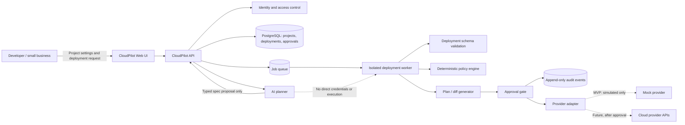
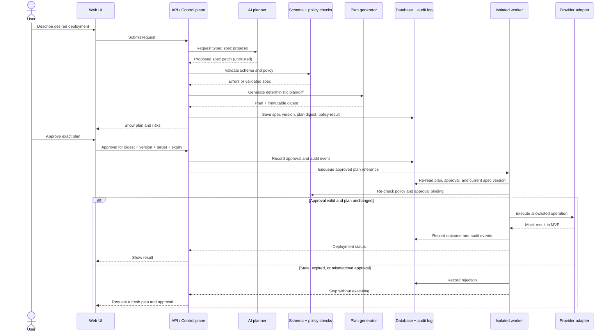
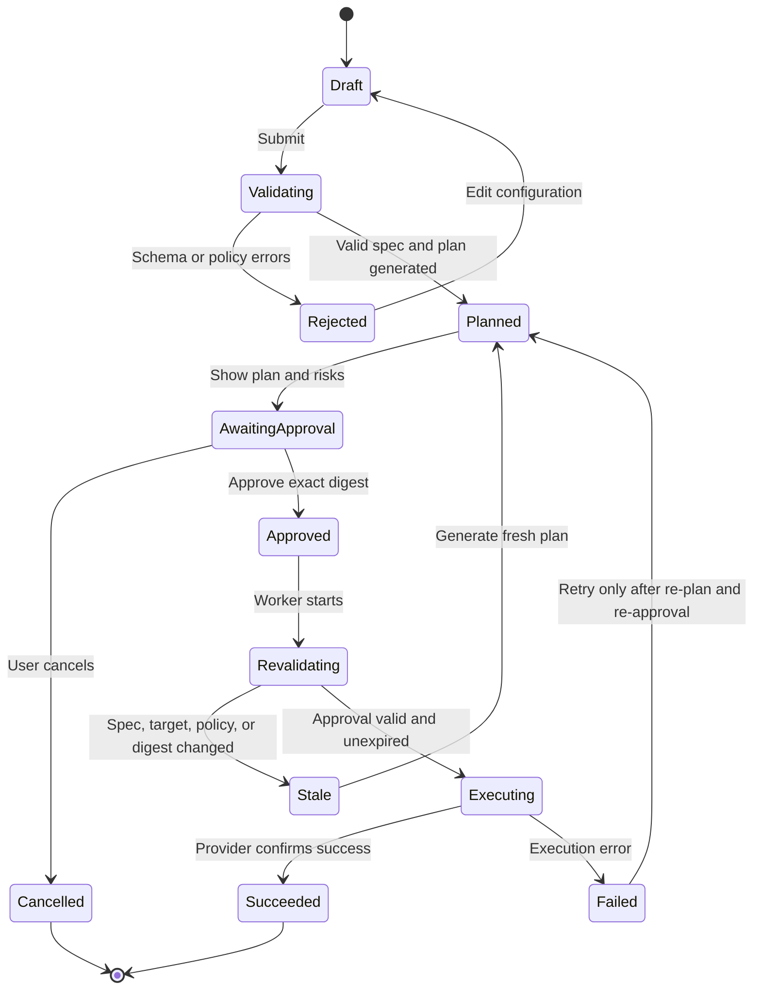
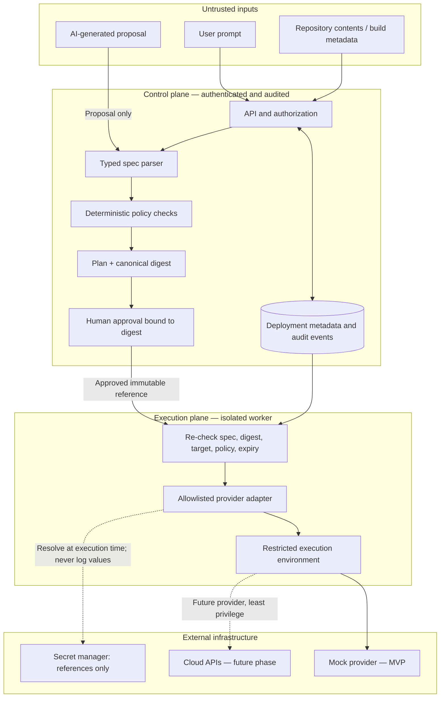
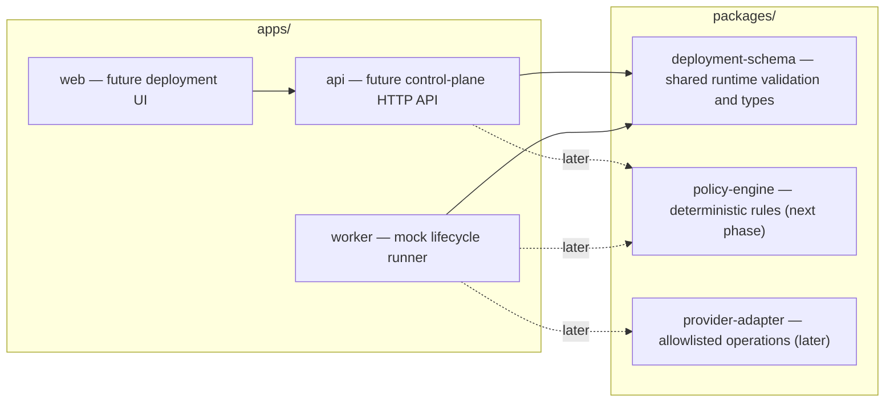

# CloudPilot AI — Architecture Diagrams (v1.0)

**Document version:** 1.0  
**Architecture scope:** CloudPilot AI V1.0 — initial design baseline  
**Scope:** Local mock deployment MVP first. Real cloud provisioning is explicitly out of scope for this milestone.

This document defines the V1.0 architecture baseline only. Later versions may revise or extend it; future delivery phases below are roadmap proposals, not features included in V1.0. These diagrams describe the intended architecture, not a claim that every component has been implemented.

## 1. System context

### Main boundaries

- **Control plane:** web UI, API, identity, project/deployment metadata, and approvals.
- **AI planning:** converts user intent into a typed deployment-spec proposal. It does not receive privileged cloud credentials and does not run commands.
- **Execution plane:** an isolated worker validates the exact spec, evaluates deterministic policies, and invokes an allowlisted provider adapter only after approval.
- **MVP boundary:** the provider adapter is a mock. No cloud API calls, infrastructure changes, or real secrets are needed.

## 2. Deployment request and approval sequence

## 3. Deployment lifecycle state machine

**Invariant:** any change to the deployment spec, target account/project, environment, policy version, or plan digest invalidates the old approval. A retry must not silently reuse a stale approval.

## 4. Security and trust boundaries

### Required security rules

1. Treat prompts, repository files, build output, and AI proposals as untrusted input.
2. Parse AI output into a versioned schema; reject unknown or invalid fields.
3. The model must never supply shell commands for privileged execution.
4. Generate a canonical plan digest and bind approval to the digest, spec version, target, environment, policy version, and expiry.
5. Revalidate immediately before execution; stale or mismatched approvals fail closed.
6. Use least-privilege, short-lived credentials in the future execution plane. Store secret references, not secret values, in deployment specs or logs.
7. Keep audit events for proposals, validation decisions, approvals, starts, results, and denials.
8. Make the mock provider the only provider implementation enabled in the first milestone.

## 5. Initial monorepo module map

## 6. Delivery phases

- **Phase 0 — Design:** agree on these boundaries, lifecycle states, and security invariants.
- **Phase 1 — Local mock MVP:** typed deployment spec, validation tests, simulated deployment lifecycle, documentation, and CI.
- **Phase 2 — Control plane:** API, persistence, authentication, deployment history, and approval records.
- **Phase 3 — UI and AI planner:** project configuration UI and AI-generated typed proposals, with no execution authority.
- **Phase 4 — Provider integration:** isolated worker, provider-specific plans, least-privilege credentials, immutable approvals, audit and rollback strategy. Start with a non-production AWS target.
- **Phase 5 — Production hardening:** threat modeling, tenant isolation, rate limits, observability, incident response, and security review.

## Decision needed before real cloud deployment

Before enabling any real provider, define the exact supported operations, account/project isolation model, credential lifecycle, rollback behavior, and approval policy. Until then, keep all deployment runs simulated.
