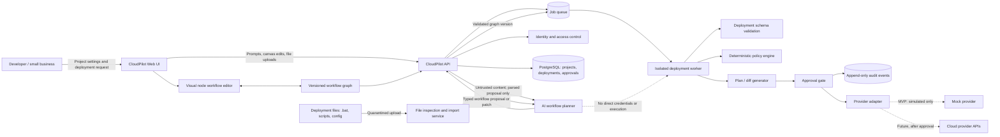
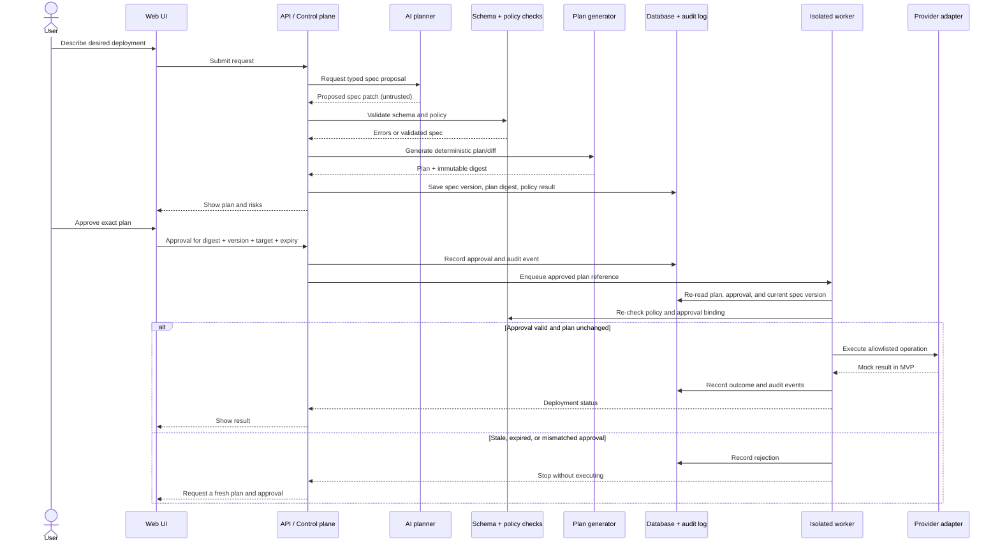
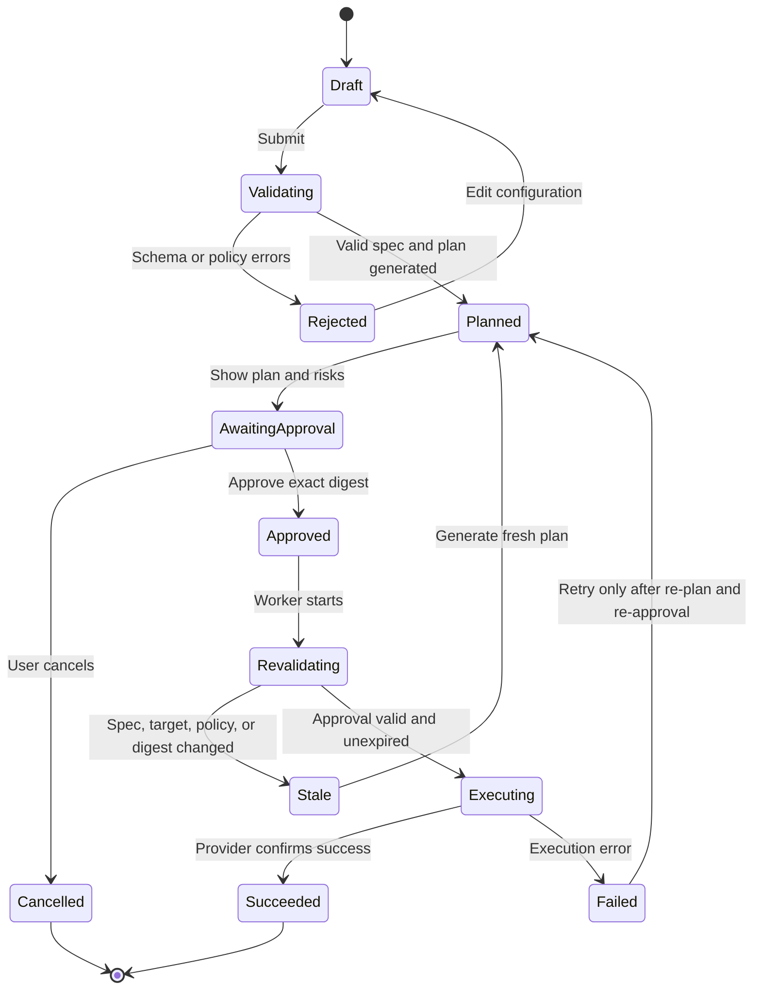
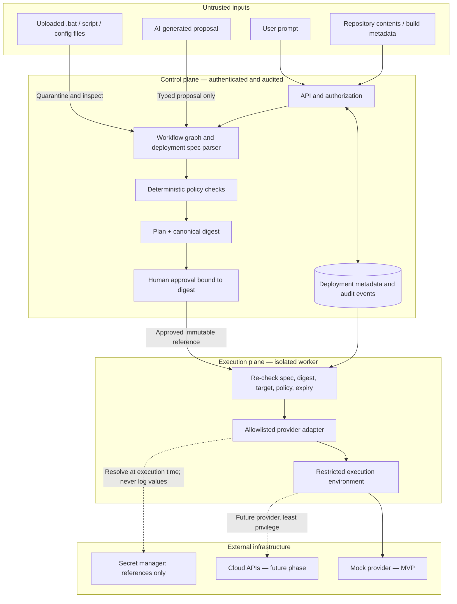
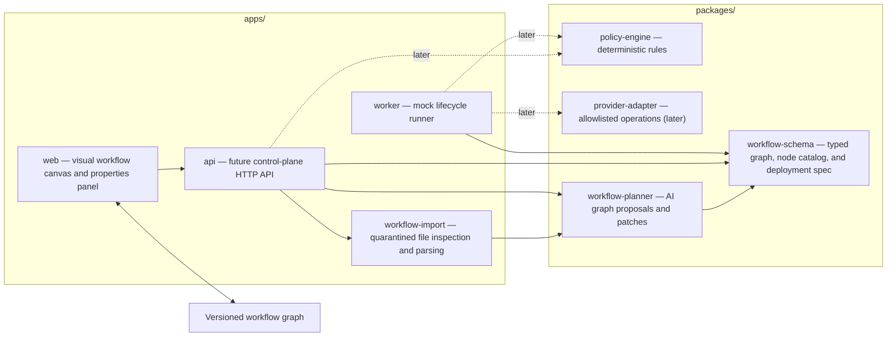

# CloudPilot AI — Architecture Diagrams (v1.1)

**Document version:** 1.1  
**Architecture scope:** CloudPilot AI V1.1 — AI-generated visual workflows and deployment-script import  
**Baseline:** Builds on the V1.0 architecture; see [V1.0 baseline](../v1.0/architecture-diagrams.md).  
**Scope:** Design for a visual node editor, AI workflow generation/editing, and safe upload/import of deployment files. Initial implementation still uses mock execution; real cloud provisioning is out of scope.

This document defines the V1.1 design proposal. It is not a claim that every component has been implemented. The V1.0 baseline remains preserved separately. The UI and workflow import features described here are design goals and must be implemented incrementally.

## 1. System context



### Main boundaries

- **Control plane:** web UI, API, identity, project/deployment metadata, and approvals.
- **AI planning:** turns user intent or inspected deployment-file content into a typed workflow graph or a proposed graph patch. AI suggestions are reviewable and editable; AI has no privileged credentials and cannot execute workflows.
- **Visual workflow editor:** renders the versioned graph as connected nodes and edges. Users can add, remove, reconnect, and configure nodes, and ask AI to propose changes. Every accepted edit creates a new workflow version.
- **File import:** accepts deployment files such as Windows `.bat` files and supported scripts/configuration as untrusted input. It inspects and parses them to suggest workflow nodes; upload does not mean the file is safe or authorized to run.
- **Execution plane:** an isolated worker validates the exact spec, evaluates deterministic policies, and invokes an allowlisted provider adapter only after approval.
- **MVP boundary:** the provider adapter is a mock. No cloud API calls, infrastructure changes, or real secrets are needed.

## 2. AI workflow generation and deployment-file import

```mermaid
sequenceDiagram
    actor User
    participant UI as Workflow canvas
    participant API as API / workflow service
    participant Files as Quarantine and file inspector
    participant AI as AI workflow planner
    participant Validator as Workflow schema + policy validator
    participant Store as Versioned workflow store

    User->>UI: Describe goal or upload .bat/script/config
    UI->>API: Prompt or upload request
    API->>Files: Store upload in quarantine (if file supplied)
    Files->>Files: Type/size checks, content inspection, malware scanning where available
    Files-->>AI: Bounded, untrusted extracted content
    API->>AI: Request workflow graph proposal
    AI-->>API: Typed graph or graph patch; no executable authority
    API->>Validator: Validate nodes, edges, settings, and policies
    Validator-->>API: Validation findings and warnings
    API->>Store: Save proposed workflow version and source provenance
    Store-->>UI: Render workflow nodes and connections
    User->>UI: Edit nodes or accept/reject AI suggestions
    UI->>API: Save new workflow version
    API->>Validator: Revalidate edited graph
    API-->>UI: Show validation result and diff
```

**Import rule:** uploaded files are reference material for analysis, not trusted workflow definitions. A `.bat` file may contain destructive commands, credential exposure, obfuscation, or environment-specific assumptions. CloudPilot must not execute an uploaded file merely because it was uploaded or parsed. If exact legacy-script execution is ever supported, it requires a separate, explicit, sandboxed capability and its own approval policy.

## 3. Deployment request and approval sequence



## 4. Deployment lifecycle state machine



**Invariant:** any change to the deployment spec, target account/project, environment, policy version, or plan digest invalidates the old approval. A retry must not silently reuse a stale approval.

## 5. Security and trust boundaries



### Required security rules

1. Treat prompts, repository files, build output, uploaded `.bat`/script/config files, and AI proposals as untrusted input.
2. Parse AI output into a versioned schema; reject unknown or invalid fields.
3. The model must never supply shell commands for privileged execution.
4. Generate a canonical plan digest and bind approval to the digest, spec version, target, environment, policy version, and expiry.
5. Revalidate immediately before execution; stale or mismatched approvals fail closed.
6. Use least-privilege, short-lived credentials in the future execution plane. Store secret references, not secret values, in deployment specs or logs.
7. Keep audit events for proposals, validation decisions, approvals, starts, results, and denials.
8. Make the mock provider the only provider implementation enabled in the first milestone.
9. Enforce upload size/type limits, quarantine files before analysis, avoid exposing secrets in extracted content, and never trust a filename or extension as proof of file safety.
10. Convert imported scripts into a proposed graph with source references and uncertainty warnings; do not claim that a generated graph perfectly reproduces every script behavior.
11. Workflow nodes must come from a typed, allowlisted node catalog. Validate graph edges, cycles, inputs, outputs, and node settings on the server; do not trust client-side canvas validation alone.
12. Require explicit approval for sensitive operations. Approval binds to the exact workflow version/digest, target, environment, policy version, and expiry.

## 6. Initial monorepo module map



## 7. Delivery phases

- **Phase 0 — Design:** agree on these boundaries, lifecycle states, and security invariants.
- **Phase 1 — Safe workflow core:** typed workflow graph, allowlisted node catalog, validation tests, simulated execution, documentation, and CI.
- **Phase 2 — Visual editor:** node canvas, connections, node configuration panel, workflow save/load, version history, and validation feedback.
- **Phase 3 — AI workflow designer:** generate workflows from natural-language requests and propose graph patches to existing workflows; user reviews changes before accepting.
- **Phase 4 — Deployment-file import:** upload `.bat` and supported script/config files, quarantine and inspect them, then generate a reviewable workflow proposal with warnings and source traceability. Do not automatically execute imported files.
- **Phase 5 — Control plane:** API, persistence, authentication, deployment history, approvals, audit events, and worker orchestration.
- **Phase 6 — Provider integration:** isolated worker, provider-specific plans, least-privilege credentials, immutable approvals, audit and rollback strategy. Start with a non-production AWS target.
- **Phase 7 — Production hardening:** threat modeling, tenant isolation, rate limits, observability, incident response, upload security, and security review.

## Product interaction principles

- The canvas is the primary workflow workspace. It should feel familiar to users of node-based automation editors, while supporting CI/CD concepts such as triggers, checkout, build, test, scan, approval, deploy, health check, and rollback.
- AI can create a new graph or propose a minimal patch to the current graph. Show a diff/summary and let users accept, reject, or manually edit it.
- Node definitions are structured data with typed inputs/outputs and documented behavior; the graph is not just a picture.
- Workflow runs should display node-level status, logs with secrets redacted, duration, and clear failure reasons.
- Support importing an existing deployment `.bat` file as an analysis input. The UI should show the file's detected steps, unsupported commands, assumptions, and uncertain mappings before the user accepts a generated workflow.

## Decision needed before real cloud deployment

Before enabling any real provider, define the exact supported operations, account/project isolation model, credential lifecycle, rollback behavior, and approval policy. Until then, keep all deployment runs simulated.
