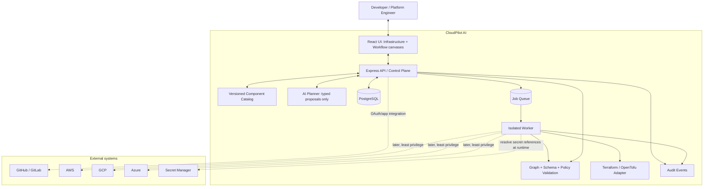

# CloudPilot AI — Architecture Overview (v1.2)

**Status:** Proposed for review  
**Product scope:** Visual-first infrastructure design + CI/CD workflows + AI-assisted planning  
**Implementation status:** Design only; not all described capabilities exist

## 1. Product vision

CloudPilot AI lets a user describe a desired application deployment or cloud architecture, generate an editable proposal, inspect the infrastructure visually, compose a workflow, preview planned changes, and eventually provision/deploy through controlled execution.

The product combines two models without collapsing them into one graph:

- **Infrastructure model:** desired cloud resources and relationships (for example VPC → subnets → application service).
- **Workflow model:** ordered and conditional actions (for example source → build → test → infrastructure plan → approval → apply → health check).

The workflow can reference infrastructure resources by stable resource identity. The infrastructure graph does not execute merely because a user draws a resource or an edge.

## 2. Architecture decisions

| ID | Decision | Rationale |
|---|---|---|
| ADR-001 | Use two distinct canvases under one project workspace | Resource topology and execution order have different semantics |
| ADR-002 | Visual-first infrastructure model is authoritative for the supported subset | Enables reliable visual editing and predictable generated IaC |
| ADR-003 | Generate Terraform/OpenTofu from a typed intermediate model | Avoids hand-generating provider-specific text from arbitrary UI state |
| ADR-004 | Import IaC only when it can be represented safely; preserve unsupported content and warn | Prevents silent loss or destructive rewrites |
| ADR-005 | Use a component catalog with versioned schemas and typed ports | Enables consistent UI, validation, AI generation and backend execution |
| ADR-006 | Use Express modular monolith for the initial backend | Keeps MVP deployable and maintainable while preserving module boundaries |
| ADR-007 | Separate API/control plane from isolated execution workers | API must not execute untrusted shell or IaC operations |
| ADR-008 | AI proposes typed diffs; deterministic validators and policies decide acceptance | Model output is untrusted and must not bypass controls |
| ADR-009 | Preview/plan before applying infrastructure changes; approval binds to immutable plan identity | Reduces accidental and unauthorized changes |
| ADR-010 | Start with mock execution; real cloud operations require a separate security review | Keeps early development safe and testable |

## 3. System context

## 4. Trust and execution boundaries

- The browser is an editor, not a trusted enforcement boundary.
- API endpoints authenticate and authorize all project/resource access.
- Component definitions are versioned and allowlisted.
- AI output, uploaded files, repository content, IaC and build output are untrusted.
- Server-side schema validation and deterministic policy checks are mandatory.
- API workers never execute arbitrary shell commands in the request process.
- Execution workers are isolated, short-lived where practical, resource-limited, and use least-privilege credentials.
- Secrets are referenced by identifier and resolved only at execution time. Secret values must not appear in prompts, graph JSON, logs or diffs.
- Real cloud execution is disabled until provider scope, credential model, approval policy, cost controls and rollback/recovery behavior are reviewed.

## 5. High-level user journey

1. Create a project and select target provider(s).
2. Design infrastructure visually or ask AI for a proposed design.
3. Review resources, relationships, assumptions and unresolved questions.
4. Generate Terraform/OpenTofu from the supported infrastructure model.
5. Create a workflow that references the infrastructure revision.
6. Validate both graphs and their cross-references.
7. Generate a plan and review its resource changes, risks and estimated impact where available.
8. Approve the exact plan and target.
9. Execute via an isolated worker.
10. Review node-level logs, outcomes, audit events and resulting infrastructure state.

## 6. Non-goals for the first implementation milestone

- No real cloud resource creation or modification.
- No arbitrary shell execution from AI output or uploaded scripts.
- No claim of full compatibility with all Terraform language features.
- No automatic conversion of every cloud architecture into a deployable configuration.
- No provider-specific UI fork for each service.
- No implicit coupling of canvas layout to execution order.
- No merging of feature branches directly into `main`.

## 7. Core quality attributes

- **Correctness:** schema validation and deterministic graph rules.
- **Safety:** plan-before-apply, approvals, isolation, least privilege and auditability.
- **Extensibility:** provider adapters and catalog-driven components.
- **Explainability:** AI changes are shown as diffs with assumptions.
- **Recoverability:** versioned designs, run history and explicit failure states.
- **Portability:** provider-specific components can coexist with provider-neutral workflow actions.
- **Testability:** graph validation, planning and policy checks are testable without cloud credentials.
