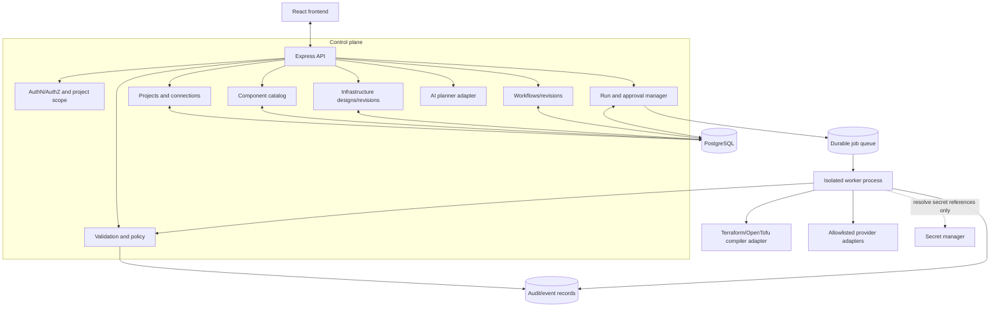

# Backend Architecture

**Status:** Proposed design  
**Technology decision:** Express + TypeScript modular monolith, PostgreSQL, isolated execution workers

## 1. Deployment shape

Start with one Express API codebase divided into modules, one worker process and PostgreSQL. Add a durable queue when background runs are introduced. Do not start with microservices; preserve boundaries in the code so modules can be extracted later if scale requires it.



## 2. Proposed monorepo layout

Keep the existing `apps/web` frontend. Add backend packages only after the design milestone is approved.

```text
apps/
  web/                    # React + TypeScript UI
  api/                    # Express HTTP control plane
  worker/                 # Isolated background execution process
packages/
  contracts/              # Shared request/response DTOs and IDs
  component-catalog/      # Component definitions and schemas
  graph-engine/           # Workflow/infrastructure graph validation
  policy-engine/          # Deterministic policy checks
  infrastructure-model/   # Desired-state model and IR
  iac-compiler/           # Terraform/OpenTofu generation/validation
  workflow-engine/        # Run scheduling and node lifecycle
  provider-adapters/      # AWS/GCP/Azure implementations (later)
  ai-planner/             # Typed proposals and diffs
  config/                 # Shared lint/typecheck/test config
```

This is a target layout, not a requirement to create every package immediately. Extract a package only when it has a clear contract and tests.

## 3. API module responsibilities

- **Projects:** project lifecycle, environment definitions and access checks.
- **Connections:** metadata for provider integrations and OAuth/role-assumption configuration; never return secret values to the browser.
- **Catalog:** list/search components and fetch exact component versions.
- **Infrastructure:** create and retrieve design revisions, validate, import/export and generate previews.
- **Workflows:** create/retrieve revisions, validate, diff and reference infrastructure revisions.
- **AI planning:** receive prompt/context, return typed proposal and diff; no direct database mutation or execution permission.
- **Runs:** plan, approval, queue, status, cancellation and logs.
- **Audit:** append security-relevant events with actor, project, target, action, timestamp and correlation IDs.

## 4. API sketch

These are conceptual routes; finalize schemas, authentication and error envelopes during implementation planning.

| Method | Route | Purpose |
|---|---|---|
| GET | `/api/v1/catalog/components` | Search/filter catalog |
| GET | `/api/v1/catalog/components/:type/:version` | Read component definition |
| POST | `/api/v1/projects` | Create project |
| GET/POST | `/api/v1/projects/:projectId/infrastructure-designs` | List/create designs |
| POST | `/api/v1/infrastructure-designs/:id/validate` | Validate design revision |
| POST | `/api/v1/infrastructure-designs/:id/preview` | Generate IaC/plan preview |
| GET/POST | `/api/v1/projects/:projectId/workflows` | List/create workflows |
| POST | `/api/v1/workflows/:id/validate` | Validate workflow and references |
| POST | `/api/v1/workflows/:id/ai-proposals` | Request typed AI proposal |
| POST | `/api/v1/workflows/:id/runs` | Create mock or approved run |
| POST | `/api/v1/runs/:runId/approvals` | Approve exact plan reference |
| GET | `/api/v1/runs/:runId` | Read status |
| GET | `/api/v1/runs/:runId/events` | Read node events/log references |

Use pagination, consistent validation errors and correlation IDs. Every route is project-scoped and authorized. Never accept client-provided user identity or rely on client-side permissions.

## 5. Persistence model

Initial relational entities:
- users, organizations, memberships and project roles;
- projects and environments;
- cloud connections and secret references;
- component definitions/catalog versions;
- infrastructure designs and immutable revisions;
- workflows and immutable revisions;
- plans and plan artifacts;
- runs and node/task runs;
- approvals;
- audit events.

Use relational columns for ownership, identity, lifecycle state, timestamps and foreign keys. Use JSONB for versioned component configuration where appropriate, validated by server-side schemas. Enforce revision uniqueness and transactional consistency.

## 6. Execution architecture

The Express API validates requests, persists revisions and schedules jobs. It does not run Terraform, cloud CLIs or arbitrary shell commands in the HTTP request process.

A worker:
1. loads an immutable run/revision reference;
2. checks authorization, target, policy and approval;
3. executes within a restricted workspace/container;
4. uses a pinned toolchain and allowlisted provider operations;
5. receives credentials through short-lived, least-privilege mechanisms;
6. redacts logs and uploads artifacts to controlled storage;
7. records node results and audit events;
8. destroys the workspace and temporary credentials.

Worker isolation, queue semantics, idempotency and cancellation must be tested before any real cloud execution.

## 7. Security requirements

- Authentication and role-based authorization on every project operation.
- Tenant/project scoping in queries and background jobs.
- Input size/rate limits and schema validation.
- CSRF/CORS/security-header configuration appropriate to the auth model.
- Secrets manager references only; never persist plaintext secrets in graph JSON.
- Log redaction and artifact access controls.
- Immutable plan and revision references.
- Worker sandboxing, time/resource limits and restricted network egress.
- Audit trails for connections, plan, approval, execution and denial.
- Dependency scanning and security tests in CI.
- Explicit policy for cost limits, public exposure, IAM privileges and destructive operations before provider activation.

## 8. Implementation order

1. Shared contracts and catalog schema.
2. Express health endpoint and test harness.
3. PostgreSQL persistence and project/workflow/infrastructure revision APIs.
4. Server-side graph validation.
5. Deterministic mock run manager.
6. AI planner interface returning validated proposals (provider can initially be a stub).
7. IaC intermediate representation and deterministic preview compiler.
8. Approval-bound execution lifecycle.
9. Isolated worker and mock adapter.
10. First real provider only after a separate security review.

Do not implement every module at once. Each stage needs acceptance criteria, tests and a reviewed PR into `dev`.
