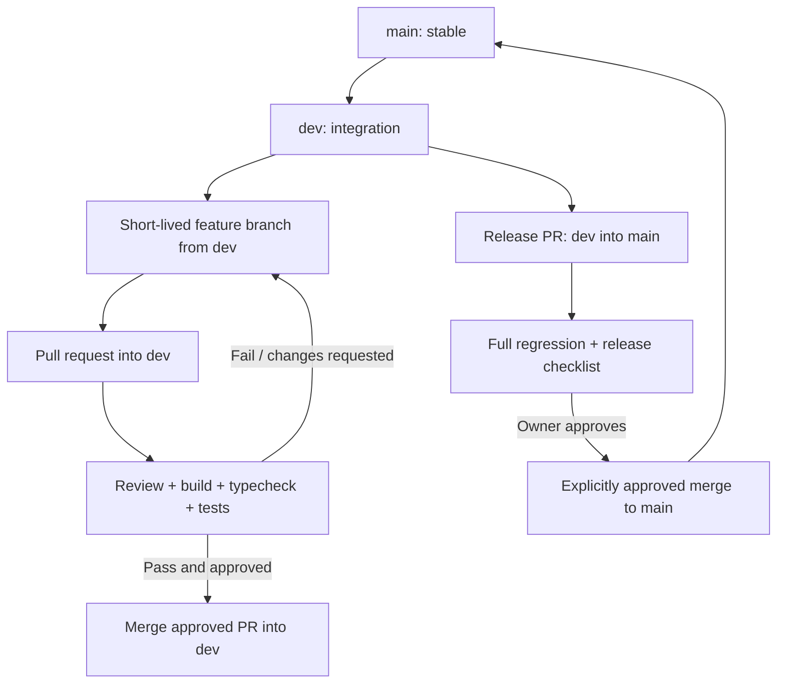

# Git Branching and Pull Request Flow

**Status:** Proposed team workflow  
**Repository:** `LChathuranga/cloudpilot-ai`

## 1. Long-lived branches

- `main` — stable/release branch. Only reviewed, tested, explicitly approved releases enter this branch.
- `dev` — integration branch. Approved feature PRs merge here; it should remain buildable.

Do not work directly on `main` or `dev`.

## 2. Short-lived branch naming

Create every work branch from the latest `dev`:

- `feature/<short-name>` — product feature.
- `fix/<short-name>` — bug fix.
- `docs/<short-name>` — documentation/design.
- `test/<short-name>` — test-only work.
- `refactor/<short-name>` — behavior-preserving refactor.
- `chore/<short-name>` — tooling or repository maintenance.

Example:
`dev → feature/component-catalog → PR into dev`

The current documentation branch for this design pack is `docs/architecture-v1.2`, based on `dev`.

## 3. Normal feature flow

## 4. Pull request rules

Each PR should:
- have a single coherent purpose;
- identify scope, design decisions and non-goals;
- link the relevant roadmap milestone;
- include tests and docs where applicable;
- state how it was verified and what remains unverified;
- avoid secrets, generated state files and unrelated formatting churn.

Before merge into `dev`:
- review the diff;
- run install/build/typecheck/tests relevant to the change;
- ensure schema or architecture changes have tests and updated docs;
- confirm no unintended changes to `main`;
- ensure PR base is `dev`.

Do not merge a PR simply because it was created. A PR remains open until review and explicit merge approval.

## 5. Release flow to main

1. Agree that `dev` contains the intended release scope.
2. Open a release PR from `dev` to `main`.
3. Run the full validation suite and manually inspect the UI.
4. Review migration and deployment notes, if any.
5. Obtain explicit owner approval.
6. Merge the release PR.
7. Tag a release and record changes where appropriate.

Never merge feature branches directly into `main`. Do not enable real cloud provisioning as a release default without its separate security sign-off.

## 6. Branch hygiene

- Keep branches short-lived.
- Rebase or update a feature branch from current `dev` before final review where practical.
- Avoid force-pushing shared branches.
- Delete merged branches when safe.
- Do not use `main` as the default source for new feature branches.
- Treat `feature/mvp-foundation` and older exploratory branches as historical until intentionally reconciled; do not merge them automatically.

## 7. Current repository note

This design pack is being prepared on `docs/architecture-v1.2` from `dev`. The intended next step is a PR into `dev`, not a merge to `main`. Older backend-experiment and cleanup branches/PRs are not automatically part of this architecture change; review them separately to avoid accidentally restoring discarded backend code.
