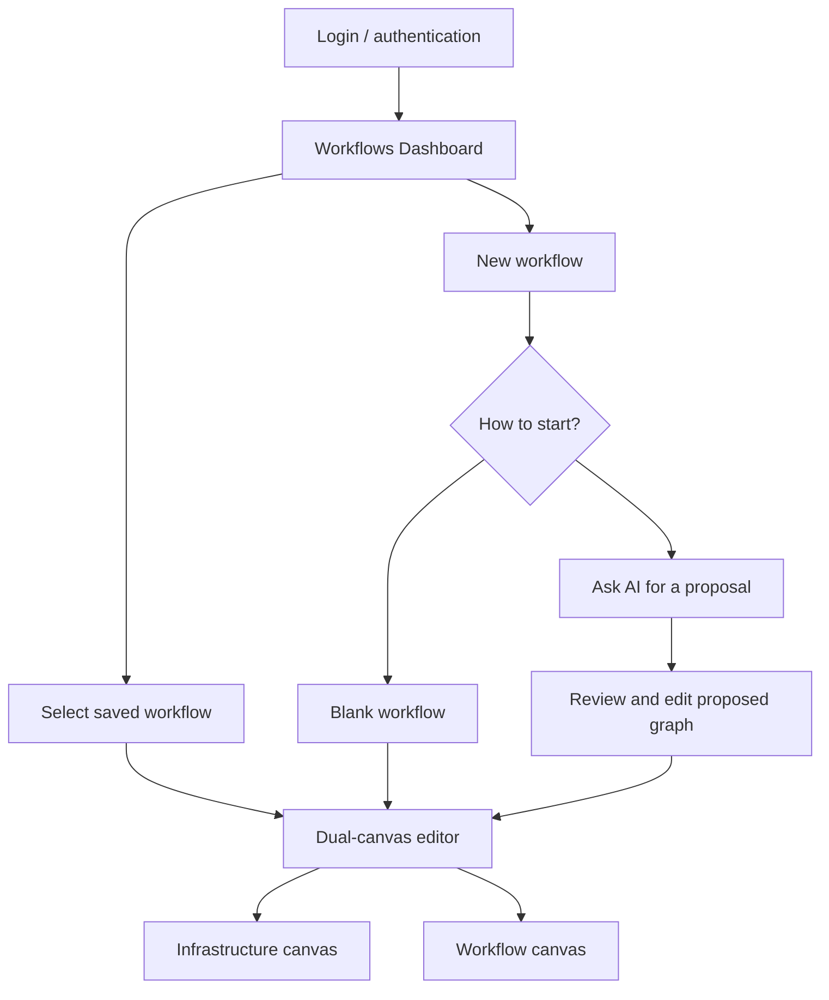

# Dual-Canvas UI Design

**Status:** Proposed design  
**Goal:** One coherent workspace for infrastructure architecture and workflow automation

## 1. Post-login landing page: Workflows Dashboard

After successful login, users should land on their **Workflows Dashboard**, not directly inside an empty editor. This page lists the workflows saved by the authenticated user and makes creating a new workflow the primary action. The dashboard is the entry point to the existing dual-canvas editor; it does not replace or combine the two canvases.

### Dashboard content

- Header with CloudPilot AI branding, workspace/project selector, account menu and global navigation.
- Page title **Workflows** with a clear **New workflow** action.
- Search and filters for workflow name, project, environment, status and last updated.
- A list/grid of the user's saved workflows. Each item shows name, short description, project/environment, last modified time and current status.
- Per-workflow actions: **Open**, **Edit**, **Duplicate**, and **Archive/Delete** (with confirmation for destructive actions).
- An empty state for new users with **Create workflow** and **Ask AI to design a workflow** actions.
- Optional recent activity and run status summaries, without making them more prominent than the user's workflows.

### Dashboard interactions

- Selecting a saved workflow opens that workflow in the dual-canvas editor, restoring its last saved revision and selected canvas where appropriate.
- **New workflow** starts a creation flow: choose a blank workflow or ask AI to propose one. AI output is a reviewable draft, not an automatically executed deployment.
- A workflow can reference an infrastructure design, but the Infrastructure and Workflow canvases remain separate views with separate graph semantics.
- The dashboard must only return workflows accessible to the authenticated user/workspace. Backend authorization must enforce ownership and membership; hiding another user's workflows in the UI is not sufficient.
- Saving from the editor persists a revision and updates the dashboard's name, status and last-modified metadata.
- If a user has no workflows, show the empty state rather than an empty table or a forced editor.

### Post-login navigation



## 2. Workspace layout

The editor workspace (opened from the Workflows Dashboard) contains:
- project/environment selector and global status;
- tabs for **Infrastructure** and **Workflows**;
- provider/component sidebar;
- central canvas;
- contextual properties panel;
- bottom drawer for validation findings, plans, logs and run history;
- AI prompt panel that proposes changes without silently applying them.

```mermaid
flowchart TB
  Top[Project selector · Environment · Save · Validate · Preview · Run]
  Top --> Tabs[Infrastructure Canvas | Workflow Canvas]
  Tabs --> Body
  subgraph Body[Editor workspace]
    Sidebar[Categorized component catalog]
    Canvas[Active graph canvas]
    Properties[Selected item properties]
  end
  Body --> Bottom[Validation · Plan / Diff · Logs · Run history]
  AI[AI prompt and proposed diff] <--> Canvas
  AI --> Review[Review / Accept / Reject]
```

## 2. Infrastructure Canvas

Purpose: edit desired infrastructure and resource relationships.

- Components represent resources, not tasks.
- Edges represent explicit infrastructure relationships, not execution order.
- Resource position is presentation metadata only; moving a node never changes the desired resource configuration.
- A selected resource opens provider-specific properties and relationships.
- Show resource identity, provider, region/project, lifecycle status and validation findings.
- Support grouping resources into modules/stacks and optionally provider/region boundaries.
- Provide a generated IaC preview and plan/diff view.
- Mark unsupported or imported constructs clearly; never silently drop them.
- Make destructive changes, public exposure and broad IAM permissions visible as warnings or policy failures.

## 3. Workflow Canvas

Purpose: edit executable or mockable action graphs.

- Components represent actions, control-flow gates, integrations and resource references.
- Edges represent control flow or typed data dependencies.
- Each action has its own configuration schema and settings panel.
- Display node-level validation and execution states.
- Provide a mock run before real execution is enabled.
- A workflow action that provisions infrastructure references a specific infrastructure revision and target; it does not treat a resource node as an arbitrary shell command.
- Support failure paths, cancellation and retry semantics explicitly rather than implying every graph is a simple linear chain.

## 4. Sidebar information architecture

### Infrastructure tab
1. Providers and project context
2. Networking
3. Compute
4. Storage
5. Databases and messaging
6. Containers and orchestration
7. Identity and security
8. Observability
9. Modules/templates

### Workflow tab
1. Triggers
2. Source control
3. Build and test
4. Containers and artifacts
5. Infrastructure as Code
6. Deployment
7. Conditions and parallelism
8. Approval and manual gates
9. Notifications and observability

Search and filters should include provider, category, maturity (design/mock/preview/supported) and whether a component is available in the selected project.

## 5. Node appearance and interaction

- Distinguish semantic families through shape, icon, labels and subtle visual styling; do not rely on color alone.
- Use a consistent node frame and consistent port placement within each family.
- Show provider logo/icon only as a cue; text must identify the service.
- Dragging a component onto the canvas creates a draft node with defaults and immediate configuration/validation feedback.
- Connecting ports opens an explanation when the relationship is ambiguous or incompatible.
- Deleting a node explains dependent references and requires confirmation when it causes graph changes.
- Undo/redo and autosave status should be visible.
- Save creates a durable revision; local draft recovery is a convenience, not a substitute for backend persistence.

## 6. AI interaction

AI can:
- generate a proposed infrastructure design;
- generate a proposed workflow;
- explain an existing graph;
- propose a small edit to selected nodes;
- map an imported supported IaC subset into visual resources;
- suggest remediation for validation findings.

AI must:
- return a typed proposal or patch, not mutate the database directly;
- state assumptions and missing inputs;
- show a diff of added/changed/removed nodes and edges;
- pass the same server-side validation as manual edits;
- require user acceptance before changing the active revision;
- never receive cloud secret values or direct execution credentials.

## 7. Example screens

### Screen A — Infrastructure
```text
+--------------------------------------------------------------------------------+
| Project: shop-app   Environment: staging   [Save] [Validate] [Generate IaC]    |
+--------------------+--------------------------------------+--------------------+
| Infrastructure     |                                      | Properties         |
| Search components  |     [VPC]                             | AWS VPC            |
| Networking         |      |                                | CIDR: 10.0.0.0/16  |
|  VPC                |  +---+---+                            | Region: ...        |
|  Subnet             |  |       |                            | Validation         |
|  Route              | [Public] [Private]                    |                    |
| Compute             |     |       |                         |                    |
|  ECS Service        | [Load Balancer] [App Service]         |                    |
+--------------------+--------------------------------------+--------------------+
| Validation findings | IaC preview | Plan/diff | Audit / history                   |
+--------------------------------------------------------------------------------+
```

### Screen B — Workflow
```text
+--------------------------------------------------------------------------------+
| Project: shop-app   Workflow: deploy-staging   [Save] [Validate] [Mock Run]    |
+--------------------+--------------------------------------+--------------------+
| Workflow            | [Trigger] -> [Checkout] -> [Build]  | Properties         |
| Triggers             |                         |            | Build              |
| Source control       |                    [Test]           | Runtime: Node.js   |
| Build & test         |                         |            | Commands: ...      |
| IaC                  |                    [Plan]            | Inputs/outputs     |
| Deploy               |                         |            |                    |
| Approval              |                    [Approve]         |                    |
+--------------------+--------------------------------------+--------------------+
| Validation | Run timeline | Node logs | Artifacts | History                       |
+--------------------------------------------------------------------------------+
```

These wireframes are structural sketches, not final visual assets.

## 8. Accessibility and usability

- Keyboard navigation for canvas selection and panels.
- Accessible labels for nodes, ports and icon-only controls.
- Clear text in addition to status colors.
- Confirmation and impact summaries for destructive operations.
- Errors should identify the component, field, and corrective action.
- Keep provider-specific complexity in progressive disclosure rather than overcrowding every node.
