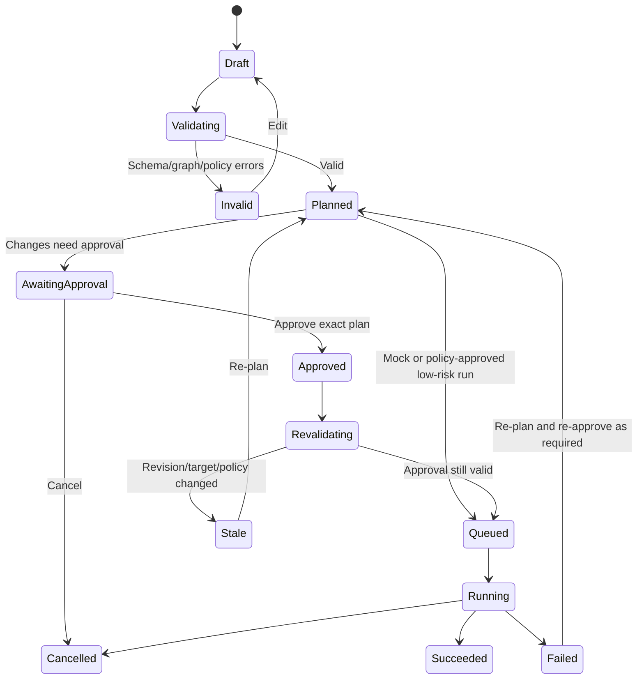

# Workflow Graph Semantics

**Status:** Proposed design  
**Scope:** CI/CD automation, infrastructure operations and deployment lifecycle

## 1. Workflow model

A workflow is a versioned directed graph. Each node references a versioned component definition and contains validated configuration. Edges are typed and may represent control flow or data flow.

```ts
interface WorkflowRevision {
  id: string;
  workflowId: string;
  revision: number;
  componentCatalogVersion: string;
  nodes: WorkflowNode[];
  edges: WorkflowEdge[];
  infrastructureRefs: InfrastructureReference[];
}

interface WorkflowNode {
  id: string;
  componentType: string;
  componentVersion: string;
  config: Record<string, unknown>;
  position: { x: number; y: number }; // presentation only
}

interface WorkflowEdge {
  id: string;
  type: "control" | "data";
  sourceNodeId: string;
  targetNodeId: string;
  sourcePort?: string;
  targetPort?: string;
}
```

The final types and runtime validation schema must be designed before implementation. Position never controls execution order.

## 2. Edge semantics

- **Control edge:** establishes when a node may become eligible to run, including branch conditions and joins.
- **Data edge:** passes a typed output to a compatible input.
- **Infrastructure reference:** links an action to an infrastructure design revision/resource. This is a reference, not a graph execution edge.

A node is runnable only when its required control dependencies are satisfied, its branch is active, its required inputs are available, and runtime policy permits it.

## 3. Graph validation

Validate at least:
- unique node and edge IDs;
- existing edge endpoints and valid port IDs;
- allowed edge types and compatible input/output types;
- required settings and enum/range constraints;
- node component type/version availability;
- required Trigger or entrypoint rules for applicable workflows;
- reachability and unreachable-node warnings;
- duplicate edges;
- unsupported cycles (unless explicit loop semantics are designed);
- valid branch/merge relationships;
- no dangling infrastructure references;
- provider/project/region compatibility where required;
- no secret values embedded in configuration;
- permission to reference the selected connection, design and environment.

Client-side validation provides immediate feedback. The API must repeat all security- and correctness-relevant checks. The worker rechecks the exact approved revision before execution.

## 4. Node execution contract

A workflow action should declare:
- validated inputs;
- typed outputs;
- timeout and cancellation behavior;
- retry policy and idempotency behavior;
- resource limits;
- required permissions/capabilities;
- redaction rules for logs;
- deterministic mock behavior, if available;
- implementation and version.

A workflow node must not provide arbitrary code or commands from AI as trusted executor code. If a supported Shell/Script action is added later, it needs explicit user authorship, sandboxing, allowlists/policy, secret scoping and approval.

## 5. Run lifecycle



Run statuses should be persisted. The UI should show node-level states, duration, logs, artifacts, retry history and failure reason.

## 6. Planning and approval binding

For infrastructure-changing operations, approval must bind to:
- workflow revision;
- infrastructure revision;
- canonical plan digest;
- provider/account/project and target environment;
- policy version;
- requester/approver identity and permissions;
- approval expiry;
- relevant component/compiler versions.

Before execution, the worker re-reads the plan and approval and verifies every binding. Any change invalidates approval. A retry must not silently reuse an old plan or approval.

## 7. Failure, retries and rollback

- Retries are explicit and bounded; only retry operations declared safe/idempotent by their component definition.
- Cancellation is best-effort and its status is recorded.
- Failure does not imply automatic deletion of created resources.
- Rollback is a separately modeled operation with its own preconditions, plan, authorization and audit record.
- Infrastructure rollback may not restore data or undo irreversible external side effects; communicate this limitation.
- Timeouts, worker loss and uncertain provider responses must be represented as uncertain/reconciliation-required states rather than falsely reported as success or failure.

## 8. Mock runner first

The first runner must be deterministic and isolated from cloud APIs. It should:
- validate a workflow;
- traverse the supported graph semantics;
- produce predictable node states, durations and redacted sample logs;
- simulate approvals and failures in tests;
- never execute shell commands;
- never read cloud credentials;
- never provision infrastructure.

A successful mock run means the simulation passed, not that the real deployment succeeded.
