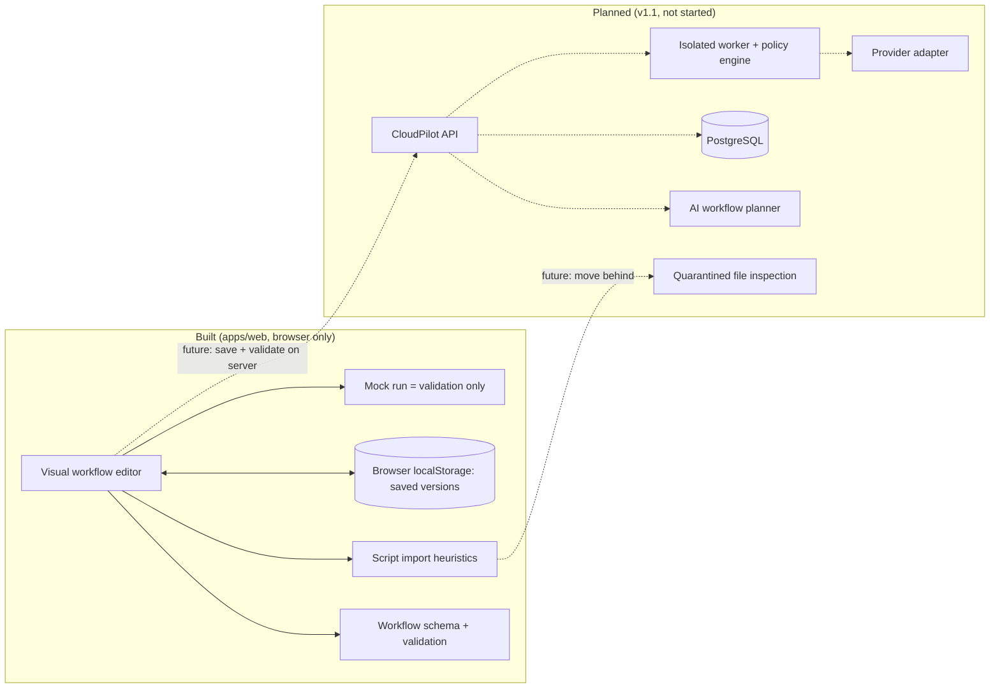
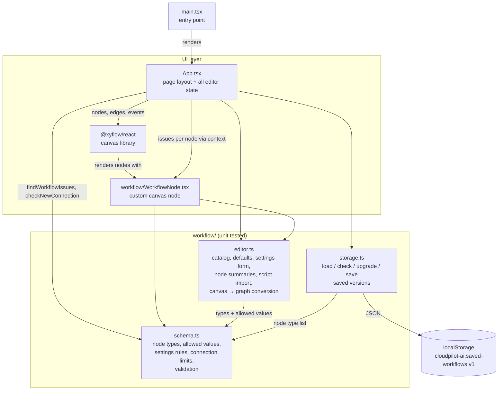
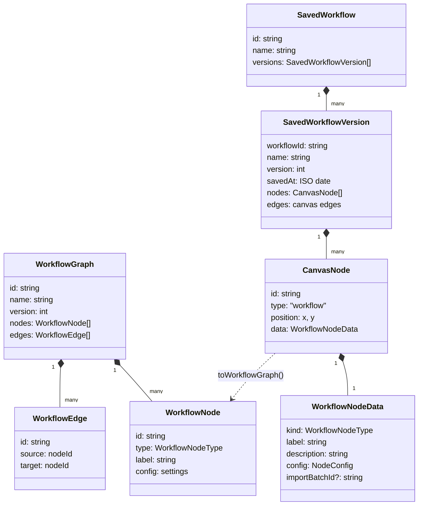
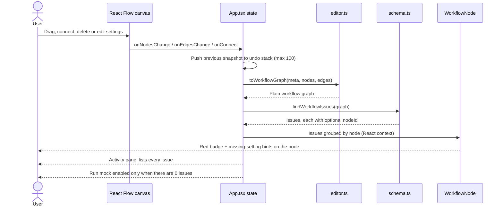
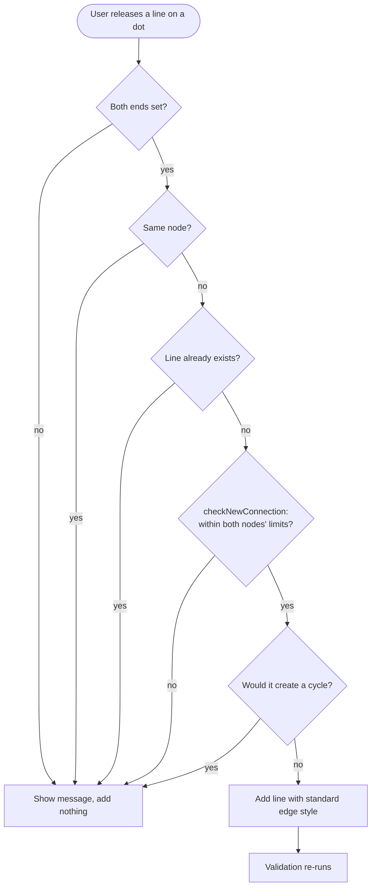
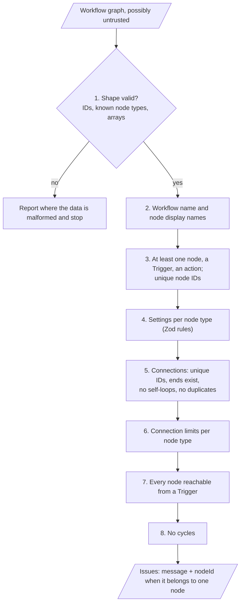
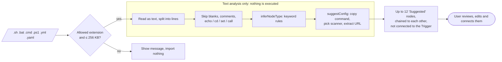

# CloudPilot AI — Workflow Editor Design

**Document version:** 1.0
**Date:** 2026-11-24
**Scope:** The web workflow editor in `apps/web` as implemented on `fix/workflow-types-and-validation`.
**Builds on:** [Architecture v1.1](../architecture/v1.1/architecture-diagrams.md). This document zooms into the *Visual workflow editor* and *Workflow graph* parts of that architecture. It describes what is built, not the full target system.

Everything described here runs in the browser. There is no API, database, AI planner or real execution yet. "Run mock" only re-runs validation.

## 1. Where the editor sits in the v1.1 architecture



| v1.1 component | Status | Notes |
|---|---|---|
| Visual workflow editor | Built | React Flow canvas, custom nodes, settings panel, undo/redo |
| Workflow graph schema + validation | Built (client only) | v1.1 also requires server-side validation |
| Versioned workflow store | Partial | Append-only versions in browser localStorage; no diff |
| Deployment-file import | Prototype | Line-by-line keyword matching; no quarantine, no secret or destructive-command warnings |
| Mock runner | Partial | Validates only; no node-by-node simulation, status or logs |
| AI planner, API, DB, auth, worker, policy, approvals, providers | Not started | |

## 2. Module structure



**Dependency rule.** `schema.ts` depends only on Zod. It has no React or React Flow imports, so it can later move to the planned `packages/workflow-schema` package and run on the server unchanged. The arrows above only point *towards* `schema.ts`.

| File | Responsibility |
|---|---|
| `schema.ts` | Single source of truth: node types and labels, allowed setting values, per-node settings rules (Zod), connection limits, `findWorkflowIssues` / `validateWorkflowGraph`, `checkNewConnection` |
| `editor.ts` | Canvas-facing data: catalog entries, default settings (type-checked against the schema), settings form fields, node summaries and colours, edge style, script-import rules, `toWorkflowGraph` |
| `storage.ts` | Reads saved versions defensively (skips damaged ones), upgrades older saves to the current canvas style, writes versions back |
| `WorkflowNode.tsx` | Draws one node: type, name, key setting, issue badge, and only the connection dots its type allows |
| `App.tsx` | Page layout and state: nodes, edges, selection, undo/redo, saved versions, notices; wires everything together |

## 3. Data model

Two shapes of the same workflow exist. The **canvas model** is what React Flow renders (positions, styling, editor-only fields). The **workflow graph** is the plain model that validation checks and that a future API would store. `toWorkflowGraph` converts one to the other.



## 4. Node catalog, settings and connection rules

Each node type defines its required settings and how many connections may come in and go out. A maximum of `0` means the node has no dot on that side. The connection limits live in `nodeConnectionLimits` in `schema.ts`; changing a rule is a one-line edit.

| Node | Required settings | Incoming | Outgoing | Reason |
|---|---|---|---|---|
| Trigger | event (manual, push, pull_request, schedule), branch | none | 1 or more | Starts the workflow and must lead somewhere |
| Source | repository URL, branch | exactly 1 | 1 or more | Code is checked out once per run and must be used |
| Build | command | 1 or more | any | Ordinary step |
| Test | command | 1 or more | any | Ordinary step |
| Security scan | scanner (trivy, npm-audit, snyk, sonarqube), severity threshold | 1 or more | any | Ordinary step |
| Approval | none (approver optional) | exactly 1 | 1 or more | Approves one step and must gate something |
| Deploy | provider (aws, gcp, azure, mock), environment, target | 1 or more | any | Ordinary step; real providers are not executed |
| Health check | URL, 3-digit HTTP status (100–599), positive timeout | exactly 1 | any | Checks the one deployment before it |
| Rollback | strategy, target | 1 or more | none | End of a recovery path |

Workflow-level rules: a workflow name (≤ 120 characters), at least one Trigger, at least one action after it, unique node and connection IDs, every node reachable from a Trigger, and no cycles.

## 5. Editing loop

Every change to the canvas re-runs the whole validation. The result drives the issue badges on nodes, the Activity panel, and whether "Run mock" is enabled.



## 6. Drawing a new connection

A connection is checked when the user releases the line. If any check fails, the line is not added and a message explains why.



## 7. Validation pipeline

`findWorkflowIssues` checks in this order. Only data that is not shaped like a workflow at all stops early; every other step always runs, so the user sees all problems at once.



A node with too few incoming connections is reported once, by step 6, rather than again as "not reachable" in step 7.

## 8. Saving and opening versions

```mermaid
sequenceDiagram
    actor User
    participant App as App.tsx
    participant Storage as storage.ts
    participant LS as localStorage

    Note over App,LS: Page load
    App->>Storage: loadSavedWorkflows()
    Storage->>LS: Read cloudpilot-ai:saved-workflows:v1
    LS-->>Storage: JSON (may be missing, old or damaged)
    Storage->>Storage: Check every version; skip damaged ones
    Storage->>Storage: Upgrade older saves to the current node and edge style
    Storage-->>App: Valid workflows + count of skipped versions
    App-->>User: Version dropdown (+ notice if anything was skipped)

    Note over User,LS: Save
    User->>App: Save workflow
    App->>App: Snapshot nodes + edges as version n + 1
    App->>Storage: storeSavedWorkflows(all workflows)
    Storage->>LS: Write JSON
    App-->>User: "Saved as version n + 1"

    Note over User,App: Open
    User->>App: Pick a version, Open
    App->>App: Replace canvas, clear undo/redo history
```

Versions are append-only and stay in the browser that saved them. There is no sharing, server copy or diff between versions yet.

## 9. Script import and its trust boundary

Uploaded scripts are untrusted reference material (v1.1 security rule 1). The importer only reads text and proposes nodes; it never runs anything.



Example mapping from the repository's `sample-deploy.sh`:

| Line | Suggested node | Pre-filled setting |
|---|---|---|
| `npm install` | Build | command = `npm install` |
| `npm run build` | Build | command = `npm run build` |
| `npm test` | Test | command = `npm test` |
| `npm audit` | Security scan | scanner = npm-audit |
| `kubectl apply -f deployment.yaml` | Deploy | defaults; target left for the user |
| `curl http://localhost:3000/health` | Health check | url = `http://localhost:3000/health` |

## 10. Safety invariants: where they stand in the editor

| Invariant (from the MVP plan) | In the editor today |
|---|---|
| Uploaded scripts are never executed | Enforced: files are only read as text |
| AI proposes typed graph changes only | Not applicable yet: no AI integration |
| Validate on the server as well as the client | **Gap:** client-side only; `schema.ts` is kept UI-free so the server can reuse it |
| No secrets in logs, prompts or diffs | **Gap:** imported lines and settings are not scanned for secrets |
| Mock runner never contacts cloud APIs | Enforced: there is no network code at all |

## 11. Next design decisions

1. **Typed outputs.** Let nodes expose outcome-specific outputs (Test: passed / failed, Approval: approved / rejected, Health check: healthy / unhealthy, Deploy: succeeded / failed) so lines such as "Health check → unhealthy → Rollback" carry meaning. This adds `sourceHandle` to `WorkflowEdge` and new validation rules.
2. **Live connection feedback.** Use React Flow's `isValidConnection` to grey out dots that would break a limit while a line is being dragged, instead of only rejecting it on release.
3. **Server-side validation.** Move `schema.ts` into `packages/workflow-schema` and run the same checks in the planned API.
4. **Import warnings.** Flag unknown commands, likely secrets and destructive operations before suggestions reach the canvas.
5. **Mock runner.** Step through the graph in order and show per-node status, duration and redacted logs, clearly marked as a simulation.
6. **Version diff.** Show what changed between two saved versions before opening or saving.
